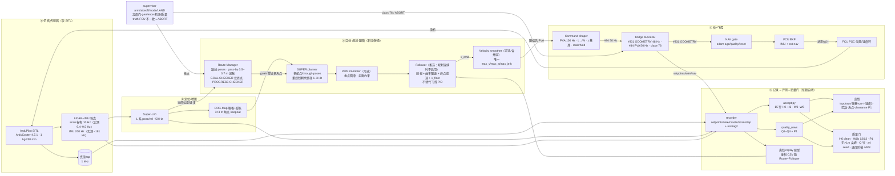

# PIPELINE — 从 SITL 到验收的完整链路

本文是**当前**链路的唯一描述（旧的 CHAIN*/DATA_PIPELINE/EXTERNAL-NAV/MISSION/SPEC/PHASE* 文档已合并进来，
过期轮次的记录合并到 `docs/FLIGHT-ANALYSIS.md` 附录）。所有路径相对仓库根。

## 1. 组件与进程

| 组件 | 位置 | 职责 |
|---|---|---|
| SITL | `.build/ardupilot/build/sitl/bin/arducopter` | ArduCopter 4.7.1，GUIDED 模式；`--model x:<json>` 可换机体 |
| 真值客户端 | `sim/src/sim_state_recv.py` | 自己的 MAVLink `SIM_STATE(108)` 客户端 → `/sim/state` 200 Hz + tap |
| 雷达/IMU 仿真 | `sim/src/lidar_imu.py` + `sim/raycast.py` | MID-360 扫描模式、**逐点位姿**（真值插值）；`/livox/lidar` 10 Hz、`/livox/imu` 200 Hz |
| Super-LIO | `slam/super_lio` | LiDAR-inertial 里程计 → `/lio/robo/odom`（200 Hz，L 系） |
| SUPER planner | `hku_super/super_planner` | 前端 A*+走廊 + MINCO 多项式轨迹；`fsm_node`，10 Hz 重规划 |
| plan box | `bridge_nodes/thin/planner_source_super.py` | 航点状态机（pacer）、目标派发、参考整形、起停 `fsm_node`、发布 `/plan/cmd` |
| FCU 客户端 | `bridge_nodes/mavlink/fcu_client.py`（merged：bridge + supervisor） | ODOMETRY #331、消息 84 PVA、supervisor 守卫、日志 |
| 验收/出图 | `scripts/accept.py`、`scripts/plot_*`、`scripts/flight_*` | 15 行验收 + 全套图 + 法医/census |

启动顺序由 `scripts/run-mission.sh` 负责：清理 → SITL → truth tap → lidar_imu → Super-LIO → plan box
（含 fsm_node）→ fcu_client → 等 LIO → 起飞 → `/plan/trigger` 放行参考 → 监控 → LAND → 落盘。

## 2. 坐标系与标定

- **W**：世界系（x=东、y=北、z=高度），真值 tap、命令行 `cmd_*`、`fcu_*` 都是 W。
- **L**：LIO 世界系（Super-LIO 自己的世界）；`/plan/cmd`、SUPER 目标、`lio_*` 都是 L。
- **wire**：MAVLink NED；1 个 `yaw` 换算只在 `common/frames.l_to_wire_yaw` 做一次。
- 标定：`calib/calib.json` 的 `R_WL`、`t_WL`（`p_W = R_WL p_L + t_WL`），`t_WL[2] ≈ 0.1156 m`。
- **高度基准**：EKF 高度基准比真值高约 **0.122 m**（原始 LIO 高度只差 1.4 cm），
  所以 plan box 用 `REF_Z_OFFSET_M=0.118` 补偿；这是 9f+ 配置的一部分（旧 9f 没补偿，真值只有 1.87 m）。
- 时间：sim 时钟 `t_sim_us` 为唯一参考；tap 与各日志都带 `t_sim_us`，`truth_timebase.json` 记录映射。

## 3. 控制链路（plan box → FCU）

```
plan box 100 Hz → /plan/cmd（quadrotor_msgs/PositionCommand，L，PVA） 
   → bridge：L→W（同一份 calib）→ MAVLink #84（50 Hz，SET_POSITION_TARGET_LOCAL_NED PVA）
   → ArduPilot GUIDED：pos+vel+acc 直接进 AC_PosControl（PVA 模式，不经过 WP_* 整形）
                 修正项受 WP_ACC/WP_JERK 限；PVA 加速度上限由 PSC_NE_JERK 控制
```

- plan box 的参考整形（9f/9f+ 相关）：
  - `--ref-v-slew`（`REF_V_SLEW`）：对**指令速度**做 slew 限幅（位置/路径不变）——1.35 干净的關鍵；
  - `--ref-z-offset-m`（`REF_Z_OFFSET_M`）：补偿 EKF 高度基准；
  - `--ref-z-hold/--ref-z-tol/--ref-z-latch-m`：把指令 z 锁成常数（`2.0 ± 0.005`）；
  - `--stale-s` / `--stale-fail-s`：SUPER 断流多久转 hold / 多久退出；
  - `--clr-gov-margin`（净空调速，实验开关）、`--ref-gov-*`（弧长/投影调速，实验开关）默认关。
- 桥的硬门限：
  - `--nav-gate-mps/--nav-gate-dps`：外导航"物理可达"校验（默认 5 m/s；速度阶梯时需同步提高，
    否则 8 m/s 的合法帧会被拒 → supervisor 误报 `ESTIMATOR IS DIVERGING`）；
  - `--nav-hz`（默认 48）、`--nav-max-age-s`、`--nav-min-quality`；
  - `--wire-hz`（默认 50）、`--setpoint-log/--wire-log/--nav-log`。
- supervisor 守卫：geofence、高度上下限、规划静默 3 s、nav 频率 floor（默认 30 Hz）、
  nav 拒绝率（`--nav-skip-max-per-s`，默认 10/s）、EKF 发散（桥外导航拒绝）、真值/FCU 位置一致性、
  LIO 断流（`--nav-floor-hz` 与 `nav_age`）。

## 4. 估计链路

```
lidar_imu（10 Hz 点云 + 200 Hz IMU）
   → Super-LIO → /lio/robo/odom（200 Hz，L）
   → bridge：ODOMETRY #331（48 Hz；零协方差，飞控按 VISO_* 参数兜底：POS 0.10 m / VEL 0.25 m/s / YAW 0.10 rad）
   → EKF3：EK3_SRC1/2/3 = 6（ExternalNav 全集），VISO_TYPE=1，VISO_DELAY_MS=10
```

实测（phase9f，扣除 0.12 m 高度基准后）：

- 原始 LIO vs 真值：p50 **0.061 m** / p90 0.087 m / p99 0.106 m，偏置 (0.000, -0.001, +0.014)；
- FCU EKF 水平误差：p50 **0.052 m** / p90 **0.086 m**；高度动态残余 std 2–3 cm；
- EKF 相对真值时延 ~45–65 ms（最佳时延修正只解释约 10% 误差）；
- 结论：**定位不是跟踪误差的主因**（去基准后占 5–12%），主因是参考跟随（尤其角点）。

## 5. 规划链路（SUPER）

- 入口：plan box 发**单个 goal 点**（PoseStamped 或 MarsMsg PVA 到 `<goal-topic>_pva`）；
- SUPER：A*（`PathSearch`）→ 走廊（`SearchPolytopeOnPath`）→ 引导路径 + 时间戳 → MINCO 优化
  → 提交多项式轨迹，10 Hz 重规划（`ReplanOnce`）。
- 终点定义：`pos_fina_state.col(0) = guide_path.back()`（≈ goal）；`goal_pva_en` 时
  `col(1)=goal_v`、`col(2)=goal_a`（终点速度/加速度）——**终点位置就是 goal**，
  所以"角点作为 goal"必然让轨迹在角点结束。
- 关键配置（`hku_super/config/super_planner_hex.yaml`）：
  `max_vel 1.35 / max_acc 6 / max_jerk 15 / max_omg 2.5 / planning_horizon 16 m / receding_dis 1.0 m /
  replan_rate 10 Hz / replan_forward_dt 0.1 s / replan_time_limit 0.35 s /
  corridor_bound_dis 0.8 / corridor_line_max_length 1.0(6.0) / map_size 24 / inflation_step 2 /
  goal_pva_en true / hot_start_en true / goal_vel_en false`。
- **已应用的补丁**（`hku_super/patches/`，`scripts/check_static.sh` 会检查关键几个）：
  | 补丁 | 内容 |
  |---|---|
  | patch 9 | 重规划时保持发布已提交轨迹（不静默） |
  | patch 10 | `super_planner/replan_time_limit` 墙钟预算（0.35 s） |
  | patch 11 | 拒绝"第一步就反向"的规划 |
  | patch 14 `patch_super_smooth_handover.py` | 新目标先走**连续重规划**（旧轨迹做 guide），失败才回退 `new_goal=true` → 显著减少角点停-走 |
  | patch 15 `patch_super_pva_tail.py` | PVA goal 后追加 `pva_tail_len` 米直线延长段（默认 0=关），让轨迹终点不在角点；**实验开关，尚未定论** |
- plan box 的目标/到达参数（当前默认 / 9f+ 值）：
  `--target-mode corner`、`--arrive-m`（默认 1.0 / 9f+ 0.3）、`--pre-goal-m 0`、`--goal-lookahead-m 0`、
  `--corner-carry-m 0`、`--goal-lead 0`、`--pass-by-m 0`、`--corner-mode bisector`、`--corner-speed 0.8`、
  `--goal-pva 1`。
  （`CORNER_EXIT_LOOK/TRIGGER` 与 `REF_DEADRECKON` 已在清理中删除——它们被真飞否决。）

## 6. 世界与任务

- 冻结地图：`sim/worlds/forest_hex12.yaml`（`check_frozen.py` 校验 SHA/柱数/角点/边长/场地墙）：
  六边形半径 10 m、相邻角点 10 m、3 圈、522 柱、柱距 1.0 m、柱 0.2 m 见方（z<2.1 m）、waypoint 3×3 空。
- 任务：从停机坪起飞到 2.0 m，依次经过 6 角点 × 3 圈（pad 也是第 1 个目标），最后回到 pad 上方。
- 大世界（速度阶梯备用）：`forest_hex12w.yaml`（970 柱）、`forest_hex16.yaml`（1546 柱）、
  `forest_hex14_low.yaml` / `forest_hex18_low.yaml`（柱高 1.2 m、飞行高度上方净空）。
- 这些世界**不是** SPEC 冻结图；用于速度/能力诊断，验收仍以冻结图为准。

## 6b. 泛化测试：同一规则、不同 seed 的地图套件（owner 2026-11-26）

冻结 SPEC 地图仍是 `sim/worlds/forest_hex12.yaml`（`check_frozen.py` 永远校验它，不参与 seed 变化）。
为了验证**泛化性**，用同一个生成器、同一几何规则、只换 seed 生成诊断地图：

```bash
python3 scripts/make_world_v2_hex.py --seed 20240522 --template sim/worlds/square15_forest.yaml \
    --arena-m 12.5 --out sim/worlds/forest_hex12_s22.yaml     # s23/s24 同理
WORLD_NAME=forest_hex12_s22.yaml <其余飞行环境> bash scripts/fly_hex2.sh gen22a 1
```

- 每张图仍为 522 柱、54 个 waypoint 空单元、六边形半径 10 m、柱距 1.0 m、飞行高度 2.0 m；
- `fly_hex2.sh` 会打印 "DIAGNOSTIC WORLD" 警告；`check_frozen.py` 仍只检查冻结图；
- 验收（`run_accept.sh`/`quality_rows.py`）使用 `WORLD_NAME` 指向的那张图；
- 评估协议：**同一套配置至少 3 个 seed 通过 15 行；调参只看最差 seed**，避免对一张图过拟合。

## 7. 数据与日志（每趟 run 目录）

```
.runs/missionA-<tag>-01-01/
  tap.csv        真值 200 Hz（pn/pe/pd；x=pe, y=pn, z=-pd）
  setpoints.csv  cmd_*（W）、fcu_*（飞控估计 W）、lio_*（LIO L）、vel/acc
  nav.csv        LIO 外导航样本（L）+ fcu_est（W）+ 拒绝原因/age
  lio.csv        Super-LIO 原始 odom 200 Hz（L）
  scans.csv      每帧雷达 cast 时间/点数/跳过原因（H6 依据）
  phase.csv      supervisor 阶段时间线
  accept.json    15 行验收结果
  traj.log       plan box + fsm_node 日志（GOAL/ARRIVED/LEG/planning 失败）
  fcu_client.log supervisor/bridge 日志（abort 原因）
  lidar_imu.log / lio.log / sitl.log / flight.BIN
  derived/       bag → CSV 派生（offline 校验用）
```

约定：
- `cmd_*`/`fcu_*` 是 W；`lio_*` 是 L（原始估计）；`accept.py` 不混用；
- 所有分析用 `t_sim_us`（sim 时钟）；`truth_timebase.json` 记录 tap 与墙钟映射；
- H6（雷达尽力而为）判据：cast p50 ≤100 ms、skipped ≤20；超限的趟**不可评分**（先 retry）。

## 8. 验收与质量门

- `scripts/accept.py`（15 行）：H1–H6（宿主/估计/链路健康）、W0–W6（任务质量，含 W1b 单调到点、W4 柱面净空、
  W2 巡航速度、W3 高度、W6 跟踪时延）。细则见 `docs/ACCEPTANCE.md`。
- `scripts/flight_quality.py`：Q1 绕圈、Q2 中段指令停顿、Q3 参考连续性、Q4 跟踪；提速前必须过。
- `scripts/flight_forensics.py`：跟踪 = 执行(cmd−EKF) + 定位(EKF−truth)，并给角点停/回摆、高度基准、LIO 误差。
- `scripts/low_speed_census.py`（owner 规则）：**先列出所有真值 |v|<0.5 m/s 的段，再逐段分类**：
  LAUNCH/LAND、CORNER-PIVOT/SLOW、MID-LEG LOOP/STALL。以后所有飞行分析以它为第一入口。
- `bash tests/run_all.sh`：全量门禁（语法/静态/模式/证据链接/时间基/nav gate/launch matrix/APE-RPE/
  criteria-v2/FCU bench/path policy/tool smoke）。

## 9. 运行约定与已知坑

1. **只飞 SITL，不飞真机**；不 push。
2. 飞行前 `bash scripts/clean_harness.sh`：清端口进程、LIO、fsm_node（SIGTERM 后可能不退出，需 `-9`）、
   `ros2 daemon`、`/dev/shm/fastrtps_*`（DDS 残留会让 LIO 收不到点云）。
3. SITL 自定义机体 JSON 只接受相对路径：`run-mission.sh` 会把模型 COPY 到 run 目录再加载。
4. 起飞是"设定点驱动"：起落架离地后 plan box 才发 `/plan/trigger`；竖直段由 plan box 自己拉高度。
5. 地图/航点冻结：`scripts/check_frozen.py` 不过就不起飞；换图必须 owner 批准并更新指纹。
6. 主机雷达仿真是尽力而为：H6 starvation 时整趟不可评分；同一配置时好时坏，必须先清理再飞。
7. `fsm_node` 的配置在 `hku_super/super_planner/config/`（`scripts/install_config_hex.sh` 负责同步）；
   修改 `hku_super/config/*.yaml` 后要拷贝到那里。

---

## 最终目标数据管线（一轮完整链路 + 每趟自动评测）

图（可直接放进报告）：`docs/evidence/final/pipeline-target.png`（源：`scripts/plot_pipeline.py`，重画：
`python3 scripts/plot_pipeline.py --out docs/evidence/final/pipeline-target.png`）。
颜色：**黑=现有保留，蓝=Nav2 式薄层重做后的新增/替换，绿=记录/评测，红=安全/监督**。



| 层 | 组件 | 频率/坐标 | 状态 |
|---|---|---|---|
| ① 仿真/传感器 | SITL（ArduCopter 4.7.1，1 kg/250 mm）；LiDAR+IMU 仿真；真值 tap | scan ~7 Hz / IMU 200 Hz；tap 1 kHz | 保留 |
| ② 定位/地图 | Super-LIO（L 系 pose/vel）；ROG-Map（栅格+膨胀，3×3 m 角点 keepout） | ~50 Hz；L | 保留 |
| ③ 目标·规划·跟随 | **Route Manager**（路线 + pass-by 记账 + 终点 goal checker + progress checker）；**SUPER 多航点/through-poses**；**Path smoother**；**RPP 式 Follower**；**Velocity smoother** | 规划 1–3 Hz；PVA 100 Hz；L/W | **重做区** |
| ④ 桥+飞控 | Command shaper（PVA、L→W、z 基准）；bridge（#331 48 Hz、#84 50 Hz、class-76）；NAV gate；FCU EKF（ext-nav）；PSC | 50 Hz 线速率；W/NED | 保留 + 整形 |
| ⑤ 监督/安全 | supervisor（arm/takeoff/mode/LAND、高度门、geofence、估计器断流/质量、plan 静默、truth-FCU 不一致） | 事件 | 保留 |
| ⑥ 记录→评测→质量门 | recorder（CSV+bag）；accept.py（15 行）；quality_rows（Q1–Q4+P1）；出图；质量门 | 每趟 | 保留 + 新增 P1 |
| 离线 | replay 原型（录制 CSV 跑 Route+Follower，不飞） | — | **新增（先验证再飞）** |

判据口径（与 `docs/ACCEPTANCE.md`、`FLIGHT-ANALYSIS` §74/§76 一致）：
H0–H6 飞行有效性 → 15 行（W1/W1b 到点、W2 速度、W6 跟踪；W4/Q2 本阶段记录）→ Q1/Q3/Q4 + **P1 规划-执行偏差与尖峰** →
≥4 张同规则不同 seed 图 → 速度阶梯（4/6/8 m/s，大世界同柱距）。

> **注（2026-11-27，owner 提问后修正）**：LiDAR 仿真的**标称扫描率是 10 Hz**（`sim/src/lidar_imu.py --scan-hz 10.0`，
> 10000 点/帧）；近期四次飞行（94a/98s22/98s23/98s24）实测 cloud **9.40–9.48 Hz**、IMU 实测 ~181 Hz，
> raycast 6–8 ms/帧。旧图里写的 "~7 Hz" 是更早、主机被抢占时的测量值（历史记录保留，但**不是本配置的规格**）；
> 换到 1546 柱的大世界（hex16/hex18）时 raycast 负载会显著上升（phase88a 曾出现 p50 22 ms、max 2.95 s、H6 FAIL），
> 所以大世界首先要解决的是 LiDAR/主机负载，而不是改 10 Hz 这个标称值。

### 补充（2026-11-27，owner 讨论后）：默认**不要**引导层，优先让规划器连续

MINCO 本身输出的就是 **位置/速度/加速度（PVA）随时间的参考**，在**同一条轨迹内**它是整形好的；实测（§54 PLANDBG）
新目标轨迹 `v_start=v_min=0.81 m/s`，角点掉速 **不是** MINCO 造成的，而是 plan-box 调速器把速度算成 0.27。
所以正确优先级是：

1. **路线 1（默认，最简）**：让 SUPER **一次规划穿过多角点**（through-poses / 保留旧角点为必经点），
   plan-box 只做**进度记账**（pass-by 半径）+ **忠实发布 committed 轨迹的 PVA** + 一个 velocity smoother/command shaper。
   **不需要 follower / 引导层**。前提是把三类不连续修掉：换轨迹时的速度方向/幅值阶跃、PlanFromRest 的停-起、
   轨迹时基与发布时间对齐（START_WT / replan_forward_dt）。
2. **路线 2（备选）**：如果 SUPER/FSM 的 rest-to-rest 结构在本轮改不动（每角点仍会重启规划），
   才用 follower（RPP 式参考重定时）去兜住手递手不连续——这是补丁，不是首选。

MPPI/MPC 的层级问题：现在的 `xva`（PVA setpoint）是**最高层**，飞控 PSC 位置/速度环 + 姿态内环都在它下面。
MPPI/MPC 若直接输出 `ω`/attitude，就**下沉到姿态/角速率层**（绕过 PSC），是控制层级变化，需要重调参与重新验收；
若只是想换"参考生成算法"，可以让 MPC/MPPI 仍然输出 PVA（积分其控制量/由模型算 a），保持现有 xva 接口不变。

---

# 附录：Nav2 对照调研（原 docs/NAV2-THIN-LAYER.md，2026-11-28 合并）


> 2026-11-27。调研对象：**ros-navigation/navigation2**，main 分支快照 commit **`c3dea921ad12`**
> （2026-11-26T18:38:07Z），各包版本 **1.5.0**。源码快照位置（本机，不在本仓库内）：
> `/mnt/d/distill_self/refs/nav2src/`（通过 GitHub API tarball 获取；`raw.githubusercontent.com` 在本机被限速，
> tarball 端点可用）。版本信息取自 `nav2_controller/package.xml`、`nav2_waypoint_follower/package.xml`。
>
> 本文只回答一个问题：**"科学、合理的薄层（把规划变成指令、判断到点、处理异常）应该长什么样"**，
> 并逐条对照我们现在的 plan-box（`bridge_nodes/thin/planner_source_super.py`）+ FSM（`super_planner/src/super_core/fsm.cpp`）。

---

## 1. Nav2 的整体拓扑（先建立坐标系）

| 组件 | 包 | 作用 |
|---|---|---|
| `NavigateToPose` action | `nav2_bt_navigator` | 单目标导航：规划→跟随→恢复，行为树驱动 |
| `NavigateThroughPoses` action | `nav2_bt_navigator` | **多目标"穿过"**：一次规划穿过一串 poses，只在最后一个点判定到达 |
| `FollowWaypoints` action | `nav2_waypoint_follower` | **逐点**导航：对每个 waypoint 调一次 `NavigateToPose`，到点后执行任务插件 |
| `ComputePathToPose` / `ComputePathThroughPoses` | `nav2_planner`（planner_server） | 全局路径（后者带 viapoints） |
| `FollowPath` | `nav2_controller`（controller_server） | 路径跟随，**内部循环里判到达** |
| recovery behaviors | `nav2_behaviors` | Spin / Wait / BackUp / DriveOnHeading / AssistedTeleop |
| path smoothing | `nav2_smoother`、`nav2_constrained_smoother` | 路径平滑（角点圆滑）后再交给控制器 |
| velocity smoothing | `nav2_velocity_smoother` | 对 cmd_vel 做加速度/加加速度限幅（运动学壳） |

关键区别先说：**Nav2 没有传统 FSM 类**，它的"状态机"是一棵 **BehaviorTree.CPP v4 的行为树**；
到达判断也不是一个 if，而是 **goal checker + progress checker + 行为树恢复** 的分层组合。
"穿过中间点不停"是 `NavigateThroughPoses`，而"到每个点停一下"是 `FollowWaypoints`——这两者 Nav2 是分开的 API。

---

## 2. Nav2 的"FSM"：行为树管道（逐节点语义）

### 2.1 单目标：`navigate_to_pose_w_replanning_and_recovery.xml`

```xml
<RecoveryNode number_of_retries="6" reset_distance="3.0" name="NavigateRecovery">
  <PipelineSequence name="NavigateWithReplanning">
    <ProgressCheckerSelector .../> <GoalCheckerSelector .../>
    <PathHandlerSelector .../> <ControllerSelector .../> <PlannerSelector .../>
    <RateController hz="1.0">
      <RecoveryNode number_of_retries="1" name="ComputePathToPose">
        <Fallback name="FallbackComputePathToPose">
          <ReactiveSequence name="CheckIfNewPathNeeded">
            <Inverter><GlobalUpdatedGoal/></Inverter>
            <IsGoalNearby path="{path}" proximity_threshold="4.0" .../>
            <TruncatePathLocal .../> <ValidatePath .../>
          </ReactiveSequence>
          <ComputePathToPose goal="{goal}" path="{path}" .../>
        </Fallback>
        <Sequence> <WouldAPlannerRecoveryHelp .../> <ClearEntireCostmap .../> </Sequence>
      </RecoveryNode>
    </RateController>
    <RecoveryNode number_of_retries="1" name="FollowPath">
      <FollowPath path="{path}" controller_id=... goal_checker_id=... progress_checker_id=... />
      <Sequence> <WouldAControllerRecoveryHelp .../> <ClearEntireCostmap .../> </Sequence>
    </RecoveryNode>
  </PipelineSequence>
  <Sequence>
    <Fallback> <WouldAControllerRecoveryHelp/> <WouldAPlannerRecoveryHelp/> </Fallback>
    <ReactiveFallback name="RecoveryFallback">
      <GoalUpdated/>
      <RoundRobin name="RecoveryActions" wrap_around="true">
        <Sequence name="ClearingActions"> <ClearEntireCostmap local/> <ClearEntireCostmap global/> </Sequence>
        <Spin spin_dist="1.57"/> <Wait wait_duration="5.0"/> <SubTree ID="BackupWithReset" backup_dist="0.30" .../>
      </RoundRobin>
    </ReactiveFallback>
  </Sequence>
</RecoveryNode>
```

可直接借用的设计要点：
1. **固定频率重规划**（`RateController hz="1.0"`）而不是"消费掉一个点就重规划"。重规划的是**剩余路径**；
   并且先做 `IsGoalNearby/TruncatePathLocal/ValidatePath`，路径还有效时**不重规划**。
2. **重试预算 + 恢复动作轮转**：外层 `number_of_retries="6"`，恢复动作是 RoundRobin（清代价地图 → Spin → Wait → BackUp），
   每次失败只做一步恢复，**恢复期间收到新目标（`GoalUpdated`）立即抢占**。
3. "规划失败/控制失败"是两类不同错误码，是否值得恢复由 `WouldAPlannerRecoveryHelp` / `WouldAControllerRecoveryHelp` 判断——不是无脑重启。

### 2.2 多目标"穿过"：`navigate_through_poses_w_replanning_and_recovery.xml`

```xml
<RateController hz="0.333">
  <RecoveryNode ... name="ComputePathThroughPoses">
    <ReactiveSequence>
      <RemovePassedGoals input_goals="{goals}" output_goals="{goals}" radius="0.7"
                         input_waypoint_statuses=... output_waypoint_statuses=.../>
      <ComputePathThroughPoses goals="{goals}" path="{path}" .../>
    </ReactiveSequence>
    ...
```

关键语义（**这正是我们缺的那一层**）：
- 一次 `ComputePathThroughPoses` 穿过**所有还没过的 poses**；0.333 Hz 重复规划剩余路线；
- **中间点由 `RemovePassedGoals`（默认 radius 0.7 m）"消耗"**，只更新 waypoint 状态，**不触发停车/不触发 controller 重起**；
- **只有最后一个 pose 由 goal checker 判定到达**；反馈里带 `distance_remaining / position_tracking_error / heading_tracking_error / number_of_poses_remaining`。
- BT 节点源码：`nav2_behavior_tree/plugins/action/remove_passed_goals_action.cpp`（构造函数默认 `viapoint_achieved_radius_(0.5)`，XML 里传入 0.7）。

### 2.3 逐点停：`nav2_waypoint_follower` 的 `FollowWaypoints`

`nav2_waypoint_follower/src/waypoint_follower.cpp`：action server `follow_waypoints`，**对每个 waypoint 调一次
`NavigateToPose`**（`nav_to_pose_client_`），等 result 回调 → 执行一次 `waypoint_task_executor`
（`WaitAtWaypoint` / `InputAtWaypoint` / `PhotoAtWaypoint`）→ 下一个。失败策略：`stop_on_failure`（继续或停）。
也就是说：**"每个点停一下"在 Nav2 里是一个上层的、显式的选择**，不是路径跟随这件事本身的语义。

> 结论：我们现在的 pacer 是"每角点发一次 goal、到了就换点并触发重规划"——语义上等价于
> **FollowWaypoints（逐点停）**，但我们期望的却是 **NavigateThroughPoses（连续穿过）**。这是设计层面的错位，
> 不是参数问题。

---

## 3. Nav2 的"到达判断"：三层，各管一件事

### 3.1 GoalChecker（插件接口）——"这个目标算到达了吗"

`nav2_core/include/nav2_core/goal_checker.hpp`：

```cpp
virtual bool isGoalReached(
  const geometry_msgs::msg::Pose & query_pose,
  const geometry_msgs::msg::Pose & goal_pose,
  const geometry_msgs::msg::Twist & velocity,
  const nav_msgs::msg::Path & transformed_global_plan) = 0;
```

内置插件（`nav2_controller/plugins/`）：
- **SimpleGoalChecker**：`xy_goal_tolerance 0.25 m`、`yaw_goal_tolerance 0.25 rad`、`path_length_tolerance 1.0 m`、`stateful true`。
  注意两点：
  - 它要求**剩余路径长度 ≤ 1.0 m** 才判 XY 到达（`isGoalXYReached` 开头：`calculate_path_length(transformed_global_plan) > path_length_tolerance_ → false`）——
    防止"路径还长但正好擦过目标附近"就判到达；
  - `stateful`：一旦进入容差窗口就保持"已到达"，直到离开 **容差 + buffer** 才复位。
- **StoppedGoalChecker**：在 Simple 基础上再要求 `|v| ≤ 0.25 m/s`、`|ω| ≤ 0.25 rad/s`（"停下才算到"）。
- 还有 PositionGoalChecker / AxisGoalChecker / AdaptiveToleranceGoalChecker（容差随速度自适应）。

### 3.2 ProgressChecker（插件接口）——"它还在动吗/是不是卡住了"

`nav2_controller/plugins/simple_progress_checker.cpp`：
- `required_movement_radius = 0.5 m`；
- `movement_time_allowance = 10.0 s`；
- `check(current_pose)`：在 10 s 窗口内是否移动过 ≥0.5 m，没动就报"无进展"，交给行为树恢复。
（另有 `pose_progress_checker` 版本。）

### 3.3 controller_server 的循环结构——到达与控制在同一个环里

`nav2_controller/src/controller_server.cpp`（FollowPath action 的执行体）：

```cpp
setPlannerPath(goal->path);
progress_checkers_[current_progress_checker_]->reset();
nav2::Rate loop_rate(this, params_->controller_frequency);
while (rclcpp::ok()) {
  waitForCostmap();
  updateGlobalPath();
  const auto current_robot_pose = getCurrentRobotPose();
  transformedPlanAndGoal(current_robot_pose);
  if (isGoalReached(current_robot_pose)) {   // ← 只有这里判"到点"
    RCLCPP_INFO(get_logger(), "Reached the goal!");
    break;
  }
  computeAndPublishVelocity(current_robot_pose);
  loop_rate.sleep();
}
```

**要点**：到达判断发生在"跟随同一个已规划路径"的循环里；不是"到点 → 重新规划 → 再跟随"。
规划在 BT 层以 1 Hz（穿过模式 0.333 Hz）独立进行，两者解耦。

---

## 4. Nav2 的"路径跟随"科学：Regulated Pure Pursuit（RPP）

`nav2_regulated_pure_pursuit_controller/src/regulated_pure_pursuit_controller.cpp`
+ `.../include/.../regulation_functions.hpp`。核心是"**前视点 + 曲率限速**"，而不是"沿航迹误差积分/比例"：

1. **前视点**（lookahead carrot）：
   ```
   L = clamp(|v| · lookahead_time, min_lookahead_dist, max_lookahead_dist)   // 速度自适应
   carrot = 沿路径弧长前推 L 的点（getLookAheadPoint）
   ```
2. **曲率与角速度**：
   ```
   k = 2·y_carrot / (x²+y²)      // 三点圆 / 弦长公式（calculateCurvature）
   ω_cmd = k · v
   ```
3. **速度约束**（applyConstraints）：
   ```
   v_curv  = curvatureConstraint(v, k, min_radius)
           = v·(1 - |R - R_min|/R_min) ，当 R < R_min；否则 v        // 弯越急越慢
   v_cost  = costConstraint(v, pose_cost, ...)                        // 靠近障碍减速
   v = min(v_curv, v_cost)
   v = max(v, regulated_linear_scaling_min_speed)                     // 有下限，≠ 0
   v = approachVelocityConstraint(v, path, min_approach_linear_velocity,
                                  approach_velocity_scaling_dist)      // 接近终点减速
   v = clamp(|v|, 0, max_linear_vel)
   ```
4. 旋转优先/原地转向（`use_rotate_to_heading`、`rotate_to_heading_angular_vel`）、角加速度限幅（`max_angular_accel`）等。
5. 还有 `nav2_graceful_controller`（平滑过渡控制器）、`nav2_mppi_controller`（采样最优控制）可选。

→ 对照我们的薄层：我们现在是
`v_cmd = clamp(KP·(沿航迹缺口), 0, |v_plan|+0.5)`，再补一个"比例下限"。
这其实是 **没有前视、没有曲率项、没有接近终点减速** 的退化跟随器；角点处"沿航迹缺口→0"必然把速度打到 0.27。
RPP 的做法是：**速度由路径曲率决定（弯道限速，但有下限），方向由前视点决定**——角点仍然会减速，但不会停，
而且减速量有几何依据（`v ≤ sqrt(a_lat·R)` 的等价形式）。

## 5. 还有两块我们也缺：路径平滑与指令平滑

- **`nav2_smoother`**（`simple_smoother.cpp` / `savitzky_golay_smoother.cpp`，另有 `nav2_constrained_smoother`）：
  在控制之前把路径角点圆滑（SimpleSmoother 迭代平滑，`do_refinement`、`refinement_num` 等；S-G 平滑是滑动多项式拟合）。
  我们的 patch 21"guide 圆角"是这件事的手工雏形，但没有独立的 smoother 层与单元测试。
- **`nav2_velocity_smoother`**：对最终 `cmd_vel` 做 `max_velocity/ max_accel / max_decel / max_jerk` 的独立限幅。
  我们的等价物是薄层里的 `REF_GOV_ACC/DEC`、FF 加速度上限、bridge clamp——散落在多处，没有单一"运动学壳"。

---

## 6. 逐条 gap：我们的薄层 vs Nav2

| 维度 | 我们（plan-box + SUPER FSM） | Nav2 | 后果 |
|---|---|---|---|
| 多目标语义 | 每角点发一个 goal；到了就换点并**重规划**；等价 FollowWaypoints（逐点停） | `NavigateThroughPoses`：一次规划穿过剩余 poses，0.333 Hz 重规划剩余路线；**中间点只做 RemovePassedGoals(0.7 m) 记账** | 角点手递手重规划 → 参考在角点停-转（我们的 0.02–0.12 m/s） |
| 到达判断 | pacer 半径/pass-by/dwell，既是记账又是控制触发器 | GoalChecker（状态化容差 + 剩余路径长度门槛 + 可选 stopped）+ ProgressChecker | "到点"与"控制"耦合；到点即重启 |
| 跟随律 | 沿航迹比例调速 + 比例下限；无前视/无曲率/无终点减速 | RPP：前视 + 曲率限速 + 障碍限速 + 终点减速 + 速度下限 | 角点速度不可解释；下限调大就切弯/振荡 |
| 重规划 | FSM：Traj finish → GENERATE_TRAJ → PlanFromRest；ReplanOnce 10 Hz | BT：1 Hz（穿过 0.333 Hz）重规划剩余路径，路径有效时不重规划 | 每个角点至少一次 rest-to-rest 重规划，交接处速度/位置不连续 |
| 恢复 | 无独立恢复层；失败就再生成/PlanFromRest；无重试预算 | RecoveryNode(6 次) + RoundRobin(清图/Spin/Wait/BackUp)，GoalUpdated 可抢占 | 失败循环、原地绕圈（P1 图里的 loop） |
| 路径平滑 | patch 21 guide 圆角（crude）；无独立 smoother/测试 | `nav2_smoother` 独立层，可配置、有单测 | 角点 guide 仍是折线 → MINCO/参考在弯里减速 |
| 指令平滑 | 散落的 Slew/ACC/FF 钳位 | `nav2_velocity_smoother` 单一运动学壳 | 层与层互相覆盖（我们已见：slew 被 no_retract 覆盖） |

---

## 7. 建议的"科学薄层"设计（按 Nav2 的分层，映射到我们栈）

### 7.1 目标/到达语义（Route Manager，替代 pacer 的"发目标"职责）
- 维护**路线 poses 列表**（我们的 12/18 个角点 + 终点）与**已通过索引**。
- 只给 SUPER 一个"**穿过多个角点**"的规划请求：
  - 近期：patch 22（`keep_old_goal_guide`）方向——新目标到达时把旧角点保留为 guide 必经点；
  - 中期：给 SUPER 增加 via-points/waypoint list（工程量大，需 owner 批准）；
  - 期间 pacer **只做进度记账**（按路径投影/半径 0.5–0.7 m 消耗角点，等价 RemovePassedGoals），
    **不再因为"到点"而触发重规划**。
- **终点才判到达**：xy 容差 0.3–0.5 m（+可选 stopped）；角点用"通过半径/投影"记账，不判停。

### 7.2 跟随律（Thin Layer = 跟随器，而不是参考积分器）
在已 committed 的 SUPER 轨迹上实现 RPP 等价物：
```
L   = clamp(k_look * v, Lmin, Lmax)              # 前视距离（随速度）
p_l = traj(τ + L/v) 或按弧长前推 L 的点           # 前视点
k   = 2·y_l / (x_l² + y_l²)                       # 轨迹局部曲率
v   = min(v_plan(τ), sqrt(a_lat_max / max(|k|, 1e-3)), v_max,
          v_approach(dist_to_final_goal))         # 曲率/终点限速
v   = max(v, v_floor)                             # 有下限（0.3–0.5），避免停
ω   = k·v
a   = 限幅(v - v_prev, ±a_max·dt)
发布 (p_ref = ∫v·dt 或直接 v feedforward, v, a)     # 保持 p/v 自洽
```
关键：**速度由"轨迹几何 + 终点距离"决定**，而不是由"沿航迹缺口"决定；因此角点会按曲率减速到可跟踪速度，
但不会因为"缺口消失"归零。`v_floor` 只在轨迹自身在动时生效（等价我们 94a 的 `REF_ALONG_FLOOR`，但加曲率项更合理）。

### 7.3 进度与恢复（FSM 层）
- **ProgressChecker**：10 s 内位移 <0.5 m → 触发一次"重规划/清图"；
- **恢复轮转**：重规划一次 → 仍失败 → Wait 3–5 s → （可选）BackUp 0.3 m → 再重规划；最多 6 次；
- **新目标可抢占恢复**（GoalUpdated 语义）；
- 不允许"无限 PlanFromRest"。

### 7.4 平滑
- 规划层：对 SUPER guide 或 committed 路径做独立平滑（S-G / Simple 等价物），并保持走廊约束；
- 指令层：把现有 Slew/FF/ACC 收敛成**一个** `velocity_smoother` 模块（max_v, max_a, max_jerk），所有覆盖层之后只经过它一次。

### 7.5 迁移步骤（不飞真机、不盲调）
1. **离线原型**：用已有录像（`tap.csv` + `setpoints.csv`）把新跟随器跑一遍；
   指标用我们现有 P1（规划-执行偏差 + 尖峰）、Q3、W6、角点真值速度，对比 44b/94a；
2. 通过后，在 SITL 上只改薄层（不改 SUPER）跑 1 趟 frozen；
3. 再加 Route Manager 的"通过型目标"（配合 patch 22），跑 4 图；
4. 最后才谈速度阶梯。

---

## 8. 可直接借鉴的 Nav2 参数（供我们设计取值）

| Nav2 参数 | 默认/示例 | 我们的对应建议 |
|---|---|---|
| `xy_goal_tolerance` | 0.25 m | 终点 0.3–0.5 m（角点用通过半径 0.5–0.7 m 记账） |
| `path_length_tolerance`（SimpleGoalChecker） | 1.0 m | 终点到达必须"剩余路径 ≤1 m"，防擦过误判 |
| `stateful` + `xy_goal_tolerance_buffer` | true / 0.0 | 沿用思路，避免容差边缘抖动 |
| `required_movement_radius` / `movement_time_allowance` | 0.5 m / 10 s | 进度检查：10 s 内 <0.5 m → 恢复 |
| `RemovePassedGoals radius` | 0.7 m | 角点消耗半径（只记账） |
| `RateController hz` | 1.0 Hz（穿过 0.333 Hz） | 重规划频率：我们现有 10 Hz 可以保留，但**只在剩余路径失效/目标更新时重规划** |
| `lookahead_time / min,max_lookahead_dist` | 1.5 s / 0.45–0.9 m | 前视距离 = clamp(1.0–1.5 s × v, 0.5, 2.0 m) |
| `regulated_linear_scaling_min_radius` | 0.9 m | 弯道限速的几何半径阈值（按我们 3 m 柱距走廊标定） |
| `regulated_linear_scaling_min_speed` | 0.25 m/s | 跟随下限 0.3–0.5 m/s（只在规划在动时） |
| `max_angular_accel` | 3.2 rad/s² | 角速度限幅（我们目前只有速度限幅） |

---

## 9. 参考链接
- 仓库：<https://github.com/ros-navigation/navigation2>（快照 commit `c3dea921ad12`，2026-11-26）
- 关键文件（相对快照 `nav2src/`）：
  - `nav2_core/include/nav2_core/goal_checker.hpp`
  - `nav2_controller/plugins/simple_goal_checker.cpp`、`stopped_goal_checker.cpp`、`simple_progress_checker.cpp`
  - `nav2_controller/src/controller_server.cpp`（FollowPath 循环，`isGoalReached` → break）
  - `nav2_bt_navigator/behavior_trees/navigate_to_pose_w_replanning_and_recovery.xml`、
    `navigate_through_poses_w_replanning_and_recovery.xml`
  - `nav2_behavior_tree/plugins/action/remove_passed_goals_action.cpp`
  - `nav2_waypoint_follower/src/waypoint_follower.cpp`
  - `nav2_regulated_pure_pursuit_controller/src/regulated_pure_pursuit_controller.cpp`、
    `include/nav2_regulated_pure_pursuit_controller/regulation_functions.hpp`
  - `nav2_msgs/action/{NavigateToPose,NavigateThroughPoses,FollowWaypoints}.action`
  - `nav2_smoother/src/simple_smoother.cpp`（+ `savitzky_golay_smoother.cpp`、`nav2_constrained_smoother`）
- 官方文档（供交叉核对）：Waypoint Follower <https://docs.nav2.org/configuration_and_development/configuration_guide/core_servers/waypoint_follower/>；
  Nav2 文档主页 <https://docs.nav2.org/>
